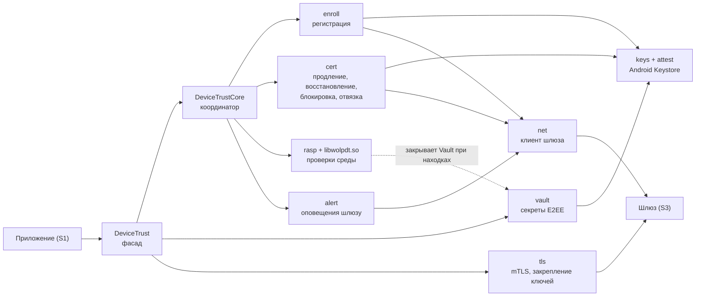

# wolp-device-trust

Android-библиотека доверия устройства для мессенджера Wolp (`org.wolpmessenger`). Она создаёт ключ устройства в Android Keystore, подтверждает его аппаратной аттестацией, получает у шлюза клиентский сертификат для mTLS и сама его продлевает, проверяет среду выполнения (RASP: root, перехватчики, отладчик) и хранит секреты сквозного шифрования в Vault — хранилище с конвертным шифрованием, ключи которого лежат в Keystore.

Библиотека написана на Kotlin, небольшая часть проверок — на C (`libwolpdt.so`). Она рассчитана на разработчика Android-приложения, которое работает со шлюзом Wolp: приложение вызывает один объект `DeviceTrust` и не занимается ключами, сертификатами и проверками само.

В документации используются три обозначения из общей спецификации проекта:

| Обозначение | Что это |
|---|---|
| S1 | приложение (`wolp-android`), которое подключает библиотеку |
| S2 | эта библиотека |
| S3 | шлюз: сервер, который проверяет аттестацию, выдаёт сертификаты устройствам и пропускает к мессенджеру только запросы с действующим сертификатом |

## Что библиотека гарантирует и чего не гарантирует

Гарантирует:

- Закрытый ключ устройства создаётся в аппаратном хранилище (TEE или StrongBox) и не покидает его. Если Keystore программный, устройство не регистрируется.
- Запросы через `DeviceTrust.okHttpClient()` идут с клиентским сертификатом устройства и только к серверу с закреплённым (pinned) ключом.
- Ключи удаляются только по ответу шлюза, полученному по закреплённому каналу, либо по решению RASP. Код отказа, увиденный в WebView, сам ничего не удаляет.
- Уничтожение ключей доводится до конца после сбоя: намерение записывается на диск раньше удаления, при следующем запуске удаление повторяется.
- Секреты сквозного шифрования (назначения `E2EE`, `E2EE_PLAINTEXT`) расшифровываются только при разблокированном экране и только после прохода RASP без блокирующих находок.

Не гарантирует:

- **RASP — дополнительный слой, а не основной.** На устройстве с root его можно обойти полностью, включая отправку оповещений. Сильный сигнал о состоянии устройства — серверная проверка аттестации на шлюзе и ежедневное продление сертификата.
- Сводка RASP, которую библиотека отправляет при продлении, подписана ключом устройства, а не доверенной средой: приложение под полным контролем атакующего пришлёт «чисто».
- Реакция BLOCK стирает всё, включая Vault. При ложном срабатывании история секретных чатов теряется так же безвозвратно, как при настоящей компрометации.
- Библиотека не содержит интерфейса, не работает с push-уведомлениями, не скачивает и не устанавливает обновления и не хранит данные веб-клиента.

## Компоненты



Подробно о каждом компоненте — в [`docs/ARCHITECTURE.md`](docs/ARCHITECTURE.md).

## Быстрый старт за 10 минут

Нужны JDK 17 или 21, Android SDK (платформа 36, build-tools), NDK `28.2.13676358` и CMake `3.22.1` — полный список в разделе [«Требования к сборке»](#требования-к-сборке).

1. Укажите окружение (пути — пример, подставьте свои):

   ```bash
   export JAVA_HOME=/opt/jdk-21.0.2 ANDROID_HOME=$HOME/Android/Sdk
   ```

2. Запустите тесты, которым не нужно устройство (163 теста на JVM):

   ```bash
   ./gradlew :devicetrust:testDebugUnitTest
   ```

3. Соберите и установите демонстрационное приложение `sample`:

   ```bash
   ./gradlew :sample:assembleDebug
   adb install -r sample/build/outputs/apk/debug/sample-debug.apk
   ```

4. Откройте на телефоне приложение «Wolp Device Trust». Шлюз ему не нужен. Оно показывает сведения об устройстве, результат предпроверки, цепочку аттестации ключа (TEE и, если есть, StrongBox), замеры скорости Keystore и Vault. Кнопка **Share report** отдаёт один JSON со всеми результатами через системное меню «Поделиться».

На эмуляторе Keystore программный, поэтому предпроверка там возвращает `Unsupported(SOFTWARE_KEYSTORE)` — это ожидаемое поведение, а не ошибка.

Остальные виды тестов, сборка `pilot` и работа с устройством описаны в [`docs/DEVELOPMENT.md`](docs/DEVELOPMENT.md).

## Как приложение подключает библиотеку

Приложение `wolp-android` подключает репозиторий git-подмодулем и подставляет модуль через составную сборку Gradle:

```kotlin
// settings.gradle.kts приложения
includeBuild("third_party/wolp-device-trust") {
    dependencySubstitution {
        substitute(module("org.wolpmessenger:devicetrust")).using(project(":devicetrust"))
    }
}
```

```kotlin
// build.gradle.kts модуля приложения
dependencies { implementation("org.wolpmessenger:devicetrust") }
```

Дальше приложение один раз вызывает `DeviceTrust.init(...)` в `Application.onCreate`, подписывается на `DeviceTrust.events`, показывает экраны по `DeviceTrust.state` и отправляет запросы через `DeviceTrust.okHttpClient()`:

```kotlin
DeviceTrust.init(this, DeviceTrustConfig(
    enrollBaseUrl = "https://enroll.<host>",
    appBaseUrl = "https://app.<host>",
    serverPins = listOf("sha256/<основной>", "sha256/<запасной>"),
    expectedSigningDigests = listOf("<SHA-256 сертификата подписи, hex>"),
))
```

Обязательные условия сборки приложения (`ndkVersion`, R8, одна подпись для продуктовой и пилотной сборок), все поля конфигурации, состояния, события и вызовы — в [`docs/API.md`](docs/API.md). Образец сборки приложения — модуль [`pilot/`](pilot/build.gradle.kts).

## Карта документации

| Документ | На какой вопрос отвечает |
|---|---|
| [`docs/API.md`](docs/API.md) | Как подключить библиотеку к приложению: что вызывать, когда и что делать с результатом; что менять при переходе с прошлой версии |
| [`docs/ARCHITECTURE.md`](docs/ARCHITECTURE.md) | Как библиотека устроена: компоненты, ключи Keystore, файлы на диске, автомат состояний, сценарии регистрации, продления, восстановления, блокировки и отвязки, поведение при сбоях |
| [`docs/RASP.md`](docs/RASP.md) | Что именно проверяет RASP: каждая проверка, реакции, зависимость от типа сборки, оповещения шлюзу, сводка при продлении |
| [`docs/DEVELOPMENT.md`](docs/DEVELOPMENT.md) | Как собирать и тестировать саму библиотеку, как добавить проверку RASP, как обновить тестовые векторы и замеры |
| [`testvectors/README.md`](testvectors/README.md) | Формат тестовых векторов для проверок на шлюзе (на английском) |
| [`bench/README.md`](bench/README.md) | Замеры скорости Keystore и Vault на устройствах (на английском) |
| [`specs/001-rasp-hardening/spec.md`](specs/001-rasp-hardening/spec.md) | Зачем и как усиливались RASP и Vault: угрозы, требования, решения |

Нормативные документы лежат в отдельном репозитории `android-messenger/docs`: `specs/S2-device-trust-lib.md` (эта библиотека), `specs/S3-gateway.md` (шлюз и его коды ошибок), `security/` (концепция безопасности). Ссылки вида «S2 §6.3» в документации и в коде указывают на разделы этих спецификаций. Если документ и код расходятся, верен код.

## Структура репозитория

| Путь | Содержимое |
|---|---|
| `devicetrust/` | библиотека (AAR); исходный код в `src/main/kotlin/org/wolpmessenger/devicetrust/`, тесты на JVM в `src/test`, тесты на устройстве в `src/androidTest`, общие для обоих в `src/sharedTest` |
| `devicetrust-native/` | `libwolpdt.so` на C: проверки RASP, чтение блока подписи APK, таблица зашифрованных строк `strings.txt`, тесты для сборочной машины в `test/` |
| `sample/` | демонстрационное и диагностическое приложение; в debug-сборке — экраны `StandEnrollActivity` и `StandRenewActivity` для регистрации и продления на стенде шлюза |
| `pilot/` | образец сборки приложения: продуктовая и пилотная сборки, R8, release-подпись, проверка `verify<Variant>BuildKind` |
| `docs/` | документация |
| `specs/` | спецификации изменений и результаты запусков на устройствах |
| `testvectors/` | цепочки аттестации с реальных устройств и векторы подписи `continuitySig` для тестов шлюза |
| `bench/` | результаты замеров |
| `tools/` | `bench.sh`, `export-testvectors.sh` и общий для них `adb-env.sh` |
| `.github/workflows/ci.yml` | непрерывная интеграция |

## Состояние и известные пробелы

Реализовано всё, что описано в [`docs/API.md`](docs/API.md). На Galaxy A37 (SM-A376B, Android 16, TEE без StrongBox) проверены: регистрация и продление на стенде шлюза, mTLS ключом Keystore по TLS 1.3 и 1.2, совпадение результатов Kotlin- и native-проверок RASP без ложных блокировок, привязка ключа Vault к блокировке экрана. Замеры — в [`bench/README.md`](bench/README.md), протоколы запусков — в [`specs/001-rasp-hardening/device-matrix.md`](specs/001-rasp-hardening/device-matrix.md).

Известные пробелы:

| Пробел | Следствие |
|---|---|
| RASP не проверен на устройстве с root (Magisk, KernelSU) и с `frida-server` | неизвестно, какие проверки срабатывают на реальном взломанном телефоне |
| Нет запусков на устройствах со StrongBox (Pixel 8 и новее, Samsung с Knox Vault) и на устройстве с заводской цепочкой аттестации | параметр `deviceKeyStrongBox` выключен по умолчанию; тестовых векторов для этих устройств нет |
| Снятие блокировки экрана на зарегистрированном устройстве проверено только тестами на JVM | поведение Keystore в этом случае на реальном устройстве не подтверждено |
| `HOOK_TAMPER` (расхождение Kotlin- и native-проверок) по умолчанию только сообщает шлюзу | решение о блокировке будет принято по данным пилота |
| Сводка RASP отправляется только шлюзу, который объявил её поддержку | до включения флага `DEVICES_RASP_SUMMARY` на шлюзе запросы продления прежние |

## Требования к сборке

| Что | Версия |
|---|---|
| JDK | 17 или 21 (Gradle 8.14.3 из обёртки не работает на более новых) |
| Gradle | 8.14.3, запускается через `./gradlew` |
| Android Gradle Plugin / Kotlin | 8.13.0 / 2.2.21 |
| Android SDK | `compileSdk` 36; `minSdk` 33 |
| NDK и CMake | `28.2.13676358` и `3.22.1` — для сборки `libwolpdt.so` |
| Для тестов native-части на сборочной машине | компилятор `cc`, `keytool` из JDK, `apksigner` из Android build-tools |
| Для тестов на устройстве, замеров и экспорта векторов | `adb` и подключённое устройство с Android 13 или новее |
