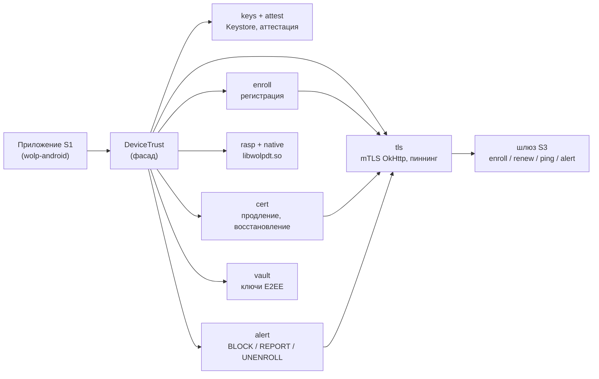

# wolp-device-trust

Android-библиотека доверия устройства (**S2**) для приложения Wolp Messenger (`org.wolpmessenger`): ключи в Android Keystore, аттестация ключей, клиентские сертификаты для mTLS и их продление, RASP, Vault для ключей E2EE. Спецификация — `android-messenger/docs` → `specs/S2-device-trust-lib.md` (контракты шлюза — `specs/S3-gateway.md`). Концепция безопасности — `docs/security/` (`02-keys-attestation.md`, `05-device-lifecycle.md`, `07-rasp.md`, `08-e2ee-vault-bridge.md`).

**Руководство по API для приложения (S1): [`docs/API.md`](docs/API.md).** Публичный API — объект `org.wolpmessenger.devicetrust.DeviceTrust` и пакет `…devicetrust.api`; остальное `internal` или закрыто opt-in `@InternalDeviceTrustApi`. Все `suspend`-функции фасада main-safe (`Dispatchers.IO`). `events` буферизуются до подписки и доставляются один раз (один подписчик на процесс).



## Модули

| Модуль | Что |
|---|---|
| `devicetrust/` | библиотека (AAR), `minSdk` 33; пакеты ниже |
| `devicetrust-native/` | `libwolpdt.so` (C): native-проверки RASP, `APK_SIGNATURE`, зашифрованные строки (`strings.txt`), host-тесты (`test/`) |
| `sample/` | демо-приложение: факты устройства, предпроверка, аттестация, замеры, отчёт; активности стенда `StandEnrollActivity`, `StandRenewActivity` |
| `pilot/` | **эталон сборки** приложения: flavors product/pilot, R8, release-подпись, `verify<Variant>BuildKind` |
| `docs/API.md` | руководство по интеграции |
| `bench/`, `testvectors/`, `testvectors-export/`, `tools/` | замеры на устройствах, тестовые векторы для S3, скрипты `bench.sh`, `export-testvectors.sh` |

Пакеты `devicetrust/src/main/kotlin/org/wolpmessenger/devicetrust/`:

| Пакет | Что |
|---|---|
| `keys/`, `attest/` | ключи EC P-256 с challenge аттестации, StrongBox → TEE, отказ `SOFTWARE`; цепочка аттестации; предпроверка (S2 §6.1) |
| `asn1/` | DER-кодировщик и PKCS#10 CSR |
| `clock/` | `TrustClock`: время сервера из закреплённого канала + `elapsedRealtime` |
| `net/`, `api/` | клиент шлюза, `GatewayCode` (S3 §5.9), публичные типы |
| `enroll/` | регистрация (S2 §6.2); пароль онбординга не становится `String` |
| `cert/` | продление (§6.3), восстановление `reattest` (§6.4), сверка при старте (§6.6), `unenroll`, `RenewWorker` |
| `tls/` | `okHttpClient()` с mTLS и пиннингом, сброс пула и SSLContext при смене `credentialsVersion`, R7; `updateHttpClient()` — только системные CA |
| `rasp/` | проверки Kotlin, политика §7.3 по типу сборки, dry run |
| `alert/` | подписанные BLOCK / REPORT / UNENROLL, очередь, `AlertWorker` |
| `vault/` | KEK `dt.vault` в Keystore оборачивает DEK; `wrap`/`unwrap` — AES-256-GCM с назначением |
| `store/` | `state.json` + `certs/<N>.pem`, атомарная запись |

## Сделано — этапы 1–7 (S2 §14, PR #1–#17 слиты)

| Этап | Что |
|---|---|
| 1 | ключи Keystore, аттестация, предпроверка, экспорт тестовых векторов, замеры TEE/StrongBox |
| 2 | Vault (конвертная схема) и замеры |
| 3 | DER/CSR, клиент шлюза, регистрация, хранилище, `TrustClock` |
| 4 | продление, восстановление, сверка §6.6, `RenewWorker` |
| 5 | mTLS-клиент: `credentialsVersion`, сброс пула и TLS-сессий, R7 |
| 6 | RASP Kotlin + native, политика §7.3, alerts (BLOCK/REPORT), `onGatewayDenied` (§5.3), `unenroll`, `checkSessionBinding`, инструментальный тест mTLS ключом Keystore |
| 7 | шифрование строк `libwolpdt.so`, native `APK_SIGNATURE` (APK Signing Block v2/v3/v3.1), `pilot/` — эталон сборки, `docs/API.md` |

Ключевые свойства:
- BLOCK при RASP — строго: сообщение, подписанное текущим ключом, **до** стирания → намерение → стирание → событие; сбой между шагами доводится при следующем старте.
- Отказ шлюза, пришедший из WebView, сам ничего не стирает: только `GET /v1/device/ping` по закреплённому каналу (не чаще раза в 30 с), действие — по его коду. Неудачный ping ничего не удаляет.
- Native-проверки сравниваются с Kotlin-проверками; расхождение → `HOOK_TAMPER`. Результат native подписан HMAC-SHA256 ключом процесса.
- `checkNativeStrings` валит сборку, если строка проверки читается в упакованной `.so`.

На **Galaxy A37** (SM-A376B, Android 16, TEE, без StrongBox): регистрация и продление против стенда, mTLS ключом Keystore (TLS 1.3 и 1.2), RASP Kotlin = native без ложных BLOCK, native `APK_SIGNATURE` = Kotlin; замеры Vault в целях S2 — [`bench/README.md`](bench/README.md). На эмуляторе Keystore программный → `Unsupported(SOFTWARE_KEYSTORE)` (S2 §15 п. 2).

## Остаток

| Что | Почему не сделано |
|---|---|
| матрица устройств S2 §13: Pixel 8+ (StrongBox, RKP), Samsung с Knox Vault, устройство с заводской цепочкой | нужны устройства; замеры StrongBox нужны для решения `deviceKeyStrongBox` (R4) |
| RASP на root-устройстве: Magisk, `frida-server` | нужно устройство с root |

## Подключение

Как в [`wolp-android`](https://github.com/android-messenger/wolp-android): git-подмодуль `app/android/third_party/wolp-device-trust` (закреплённый коммит `main`) и `includeBuild` с подстановкой модуля:

```kotlin
// settings.gradle.kts приложения
includeBuild("third_party/wolp-device-trust") {
    dependencySubstitution {
        substitute(module("org.wolpmessenger:devicetrust")).using(project(":devicetrust"))
    }
}
```

Обязательно: `ndkVersion` в модуле приложения (иначе `libwolpdt.so` попадёт в APK с символами), R8, одна release-подпись для product и pilot. Полный список — [`docs/API.md` §1](docs/API.md#1-подключение), образец сборки — [`pilot/build.gradle.kts`](pilot/build.gradle.kts). Репозиторий приватный: CI `wolp-android` забирает его deploy-ключом только на чтение.

## Sample app

`sample/` — приложение на Compose, шлюз не нужен: факты устройства, предпроверка, аттестация ключа (TEE и StrongBox, цепочка), замеры Keystore/Vault против целей S2 и **Share report** — один JSON со всеми результатами и свежими тестовыми векторами через системное меню «Поделиться».

```bash
./gradlew :sample:assembleDebug
adb install -r sample/build/outputs/apk/debug/sample-debug.apk
```

CI публикует APK артефактом `sample-debug-apk` каждого запуска. Стенд регистрации (`wolp-android/p1/stand/devices`, `enroll.sh`, `renew.sh`) запускает `StandEnrollActivity` / `StandRenewActivity` из debug-сборки `sample`.

## Эталон сборки (`pilot/`, S2 §7.3)

Flavors `product` (`buildKind` RELEASE, `versionCode` `MMmmpp`, `pp` 00–89) и `pilot` (PILOT, `pp` 90–99, `raspDryRun`), **один applicationId** (пилот обновляется до релиза на месте), R8, одна release-подпись, `ndkVersion`. `verify<Variant>BuildKind` перед каждой release-сборкой отказывает при неверном типе, диапазоне `versionCode`, dry run в product, debuggable release, отсутствии подписи или подписи не из `expectedSigningDigests`. Приложение показывает факты сборки, состояние и `checkIntegrity()` (тег `DT-PILOT`).

```bash
./gradlew $SIGN -Pwolp.expectedSigningDigests=<hex> :pilot:assembleProductRelease :pilot:assemblePilotRelease
./gradlew $SIGN -Pwolp.pilot.wrongDigest=true …   # демонстрация: APK_SIGNATURE BLOCK / dry-run REPORT
```

`$SIGN` — свойства `wolp.signing.storeFile`, `storePassword`, `keyAlias`, `keyPassword`.

## Сборка и проверки

Gradle 8.14 требует JDK 17–21.

```bash
./gradlew :devicetrust:testDebugUnitTest          # JVM-тесты
./gradlew :devicetrust:connectedDebugAndroidTest  # на устройстве: настоящий Keystore
./gradlew checkForbiddenDependencies              # нет Firebase / Play Services (S2 §15 п. 1)
./gradlew :devicetrust:checkNativeStrings         # нет открытых строк проверок в libwolpdt.so
devicetrust-native/test/run.sh <apk>              # host-тесты native (ASan/UBSan; нужны cc, keytool, apksigner)
tools/bench.sh [-s serial]                        # → bench/<model>.json (Keystore + Vault)
tools/export-testvectors.sh [-s serial]           # → testvectors/<model>/*.json
```

CI (`.github/workflows/ci.yml`): JVM-тесты, `checkForbiddenDependencies`, сборка AAR/sample/тестовых APK, `checkNativeStrings`, host-тесты native, pilot-сборки одноразовым ключом, APK `sample` артефактом.
