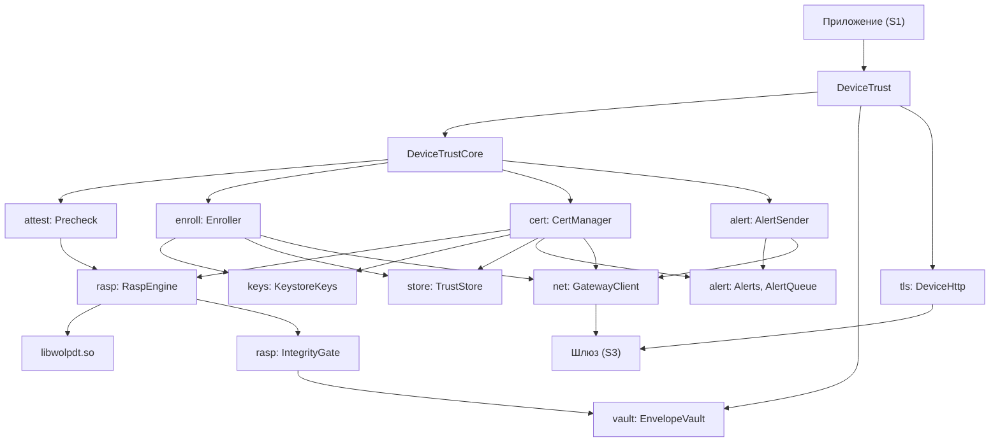
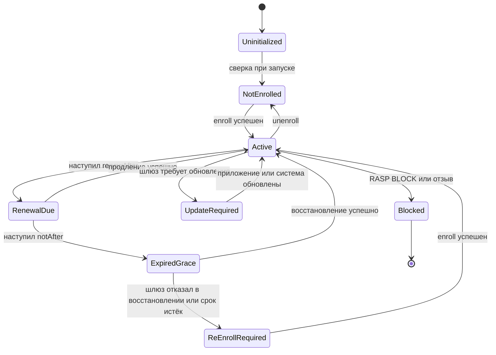
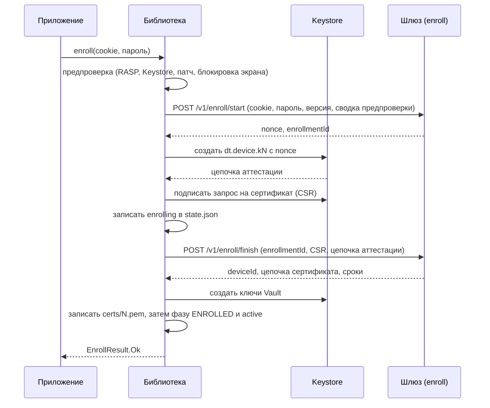
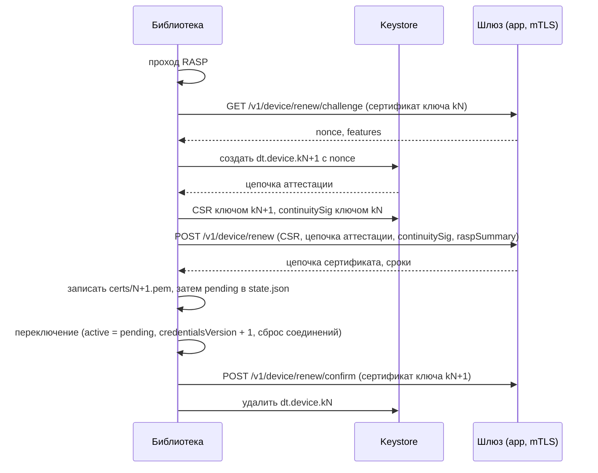
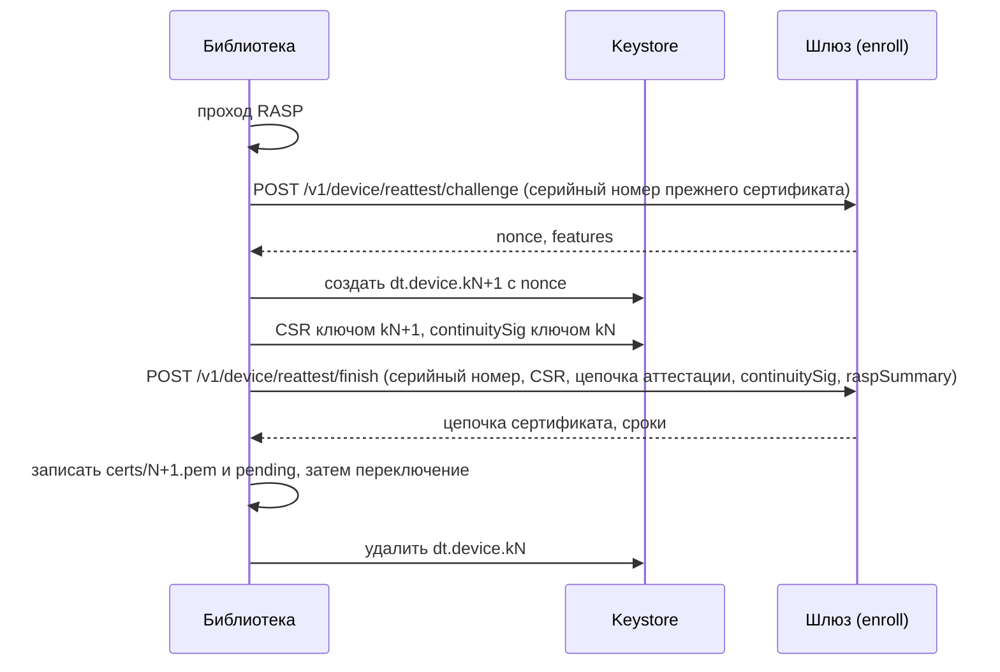
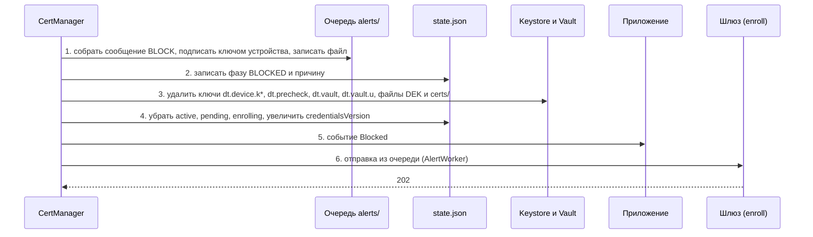

# Архитектура `wolp-device-trust`

Документ объясняет, как библиотека устроена внутри: из каких частей она состоит, какие ключи и файлы создаёт, как меняется состояние устройства и что происходит в каждом сценарии, включая сбои. Он нужен тому, кто дорабатывает библиотеку или разбирает её поведение. Как пользоваться библиотекой из приложения — в [`API.md`](API.md); проверки среды выполнения — в [`RASP.md`](RASP.md).

Обозначения: S1 — приложение, S2 — эта библиотека, S3 — шлюз. Ссылки вида «S2 §6.3» и «S3 §5.4» указывают на разделы спецификаций `specs/S2-device-trust-lib.md` и `specs/S3-gateway.md` в репозитории `android-messenger/docs`. Там, где спецификация и код расходятся, документ следует коду.

## 1. Основные понятия

| Понятие | Значение |
|---|---|
| Ключ устройства | пара ключей EC P-256 в Android Keystore. Закрытый ключ не извлекается; им подписываются запрос на сертификат, TLS-рукопожатие и сообщения шлюзу |
| Аттестация ключа | цепочка сертификатов, которую Keystore выдаёт вместе с ключом. Она доказывает шлюзу, что ключ создан в аппаратном хранилище этого устройства, и содержит одноразовое число (nonce) шлюза. Библиотека цепочку не проверяет — только передаёт; проверяет шлюз (S3 §6) |
| Сертификат устройства | короткоживущий клиентский сертификат, который шлюз выдаёт на ключ устройства. Его сроки: `notAfter` — конец действия, `renewAfter` — момент, с которого пора продлевать |
| Регистрация (enroll) | первое получение сертификата по паролю онбординга |
| Продление (renew) | получение сертификата на новый ключ, пока прежний сертификат действует |
| Восстановление (reattest) | получение сертификата на новый ключ, когда прежний сертификат истёк или вытеснен |
| `continuitySig` | подпись прежним ключом устройства над данными о новом ключе. Доказывает шлюзу, что новый ключ запросило то же устройство |
| Закреплённый канал | HTTPS-соединение, в котором открытый ключ сервера сверяется со списком из конфигурации (`serverPins`) |
| Vault | хранилище секретов с конвертным шифрованием: данные шифруются ключом DEK в памяти процесса, а сам DEK лежит на диске зашифрованным ключом KEK из Keystore |
| RASP | проверки среды выполнения; реакция BLOCK стирает ключи, реакция REPORT отправляет сообщение шлюзу |
| Оповещение (alert) | сообщение шлюзу о блокировке (`BLOCK`), находках (`REPORT`) или отвязке (`UNENROLL`) |

## 2. Компоненты

Весь код библиотеки лежит в `devicetrust/src/main/kotlin/org/wolpmessenger/devicetrust/`.



| Пакет или файл | Ответственность |
|---|---|
| `DeviceTrust.kt` | Фасад и единственная точка входа приложения. В `init` создаёт и связывает все остальные объекты, запускает сверку при запуске, проходы RASP на переднем плане и таймер сроков. Переводит все `suspend`-вызовы на `Dispatchers.IO` |
| `DeviceTrustCore.kt` | Координатор. Держит единую блокировку для операций, меняющих состояние; публикует `state` и `credentialsVersion`; реализует обработку отказов шлюза из WebView и проверку привязки сессии |
| `api/` | Публичные типы: конфигурация, состояния, события, результаты, `Vault`, идентификаторы проверок RASP |
| `keys/` | `KeystoreKeys`: создание ключа устройства (StrongBox с откатом на TEE), проверка уровня защиты, нумерация псевдонимов, удаление «сирот». `KeyStoreBackend` — интерфейс над Android Keystore, чтобы логика тестировалась на JVM |
| `attest/` | `Precheck` — предпроверка устройства; `PrecheckCache` — кэш уровня Keystore; `AttestationChain` — обёртка над цепочкой аттестации для диагностики и тестовых векторов |
| `asn1/` | Собственный кодировщик DER (`Der`) и запрос на сертификат PKCS#10 (`Csr`) |
| `enroll/` | `Enroller` — регистрация и повтор её завершения после сбоя; `EnrollStartBody` — тело первого запроса, которое собирается прямо в массив байтов, чтобы пароль не становился строкой |
| `cert/` | `CertManager` — продление, восстановление, обработка отказов шлюза, блокировка, отвязка, сверка при запуске; `ContinuitySig` — формат подписываемых данных; `RenewWorker` — фоновая задача WorkManager |
| `net/` | `GatewayClient` — вызовы шлюза; `GatewayError` — разбор отказа; `HttpClients` — закреплённый клиент OkHttp и клиент с одним заданным сертификатом |
| `tls/` | `DeviceHttp` — два клиента для приложения (`okHttpClient()` и `updateHttpClient()`), смена сертификата без пересоздания клиента, повтор запроса, отправленного с прежним сертификатом; `FixedKeyManager` |
| `rasp/` | `KotlinChecks` и `NativeChecks` — проверки; `RaspEngine` — один проход, сравнение двух реализаций, второй проход; `EffectivePolicy` — реакции с учётом типа сборки; `IntegrityGate` — запрет на выдачу секретов Vault; `RaspSummaryStore` — счётчики сводки |
| `alert/` | `Alerts` — сборка и подпись сообщений; `AlertQueue` — очередь на диске и ограничение частоты; `AlertSender` и `AlertWorker` — доставка |
| `vault/` | `EnvelopeVault` — Vault; `Kek` — ключи Keystore, шифрующие DEK; `AndroidScreenLock` — состояние блокировки экрана |
| `store/` | `TrustStore` — файл состояния `state.json` и файлы цепочек сертификатов |
| `clock/` | `TrustClock` — время относительно сервера |
| `io/` | `AtomicFiles` — атомарная запись файла |
| `Journal.kt` | Журнал: logcat с тегом `DeviceTrust`; только названия событий, коды и состояния |

Native-часть лежит в `devicetrust-native/`: `src/rasp.c` (проверки и точка входа JNI), `src/apksig.c` (чтение блока подписи APK), `src/sha256.c`, `src/obf.h` и `strings.txt` (зашифрованные строки). Она описана в [`RASP.md`](RASP.md#7-защита-native-части).

## 3. Ключи Android Keystore

| Псевдоним | Тип | Свойства | Время жизни |
|---|---|---|---|
| `dt.device.k<N>` | EC P-256, только подпись | Дайджесты `SHA-256` и `NONE` (второй нужен для подписи в TLS-рукопожатии). Без требования аутентификации пользователя и без привязки к блокировке экрана: сертификат должен работать в фоне. Одноразовое число шлюза передаётся как вызов аттестации. При `deviceKeyStrongBox = true` создаётся в StrongBox, при неудаче — в TEE | От регистрации или продления до следующего продления. `N` — наибольший существующий номер плюс один, начиная с 1 |
| `dt.precheck` | такой же, без вызова аттестации | Пробный ключ предпроверки: по нему определяется уровень защиты Keystore | Создаётся и сразу удаляется |
| `dt.vault` | AES-256-GCM | KEK «фоновой» половины Vault (назначения `NAMES`, `PUSH_KEY`). Без привязки к блокировке экрана | От регистрации до блокировки, отвязки или пересоздания Vault |
| `dt.vault.u` | AES-256-GCM, `setUnlockedDeviceRequired(true)` | KEK половины E2EE (назначения `E2EE`, `E2EE_PLAINTEXT`). Система отказывает в операции, пока экран заблокирован | То же |

Ключ, уровень защиты которого не `TRUSTED_ENVIRONMENT` и не `STRONGBOX`, удаляется сразу после создания, и регистрация прекращается с причиной `SOFTWARE_KEYSTORE`.

## 4. Данные на диске

Все файлы лежат в `noBackupFilesDir/dt/` — каталоге, который не попадает в резервные копии. Каждая запись атомарна: данные пишутся во временный файл `<имя>.tmp`, сбрасываются на диск и переименовываются (`AtomicFiles`). Файл цепочки сертификатов записывается раньше состояния, которое на него ссылается.

| Файл | Содержимое | Кто пишет | Переживает блокировку и отвязку |
|---|---|---|---|
| `state.json` | Фаза (`phase`), `deviceId`, действующий сертификат `active` и ожидающий переключения `pending` (псевдоним ключа, серийный номер, сроки), незавершённая регистрация `enrolling` (идентификатор, псевдоним, запрос на сертификат, цепочка аттестации, время создания), `credentialsVersion`, привязка времени `clock`, сведения `updateRequired`, причина блокировки `blockReason`. Секретов нет; файл не шифруется и не подписывается | `TrustStore` | да, меняется его содержимое |
| `state.json.corrupt` | Отложенный файл состояния, который не удалось разобрать | `TrustStore` | да |
| `certs/<N>.pem` | Цепочка сертификата для ключа `dt.device.k<N>`: сертификат устройства и промежуточный | `TrustStore` | нет |
| `dek.bin` | DEK фоновой половины Vault, зашифрованный ключом `dt.vault`: байт версии, вектор инициализации, шифртекст с меткой | `EnvelopeVault` | нет |
| `dek-u.bin` | DEK половины E2EE, зашифрованный ключом `dt.vault.u` | `EnvelopeVault` | нет |
| `precheck.properties` | Кэш уровня защиты Keystore: счётчик загрузок телефона, `versionCode`, уровень, признак отката со StrongBox | `FilePrecheckCache` | да |
| `rasp-summary.json` | Счётчики сводки RASP между продлениями | `RaspSummaryStore` | да; удаляется при новой регистрации |
| `alerts/<время>-<номер>-<uuid>.json` | Готовое к отправке сообщение шлюзу, по одному файлу на сообщение | `AlertQueue` | да |
| `reports/pending.json` | Находки с реакцией REPORT, ещё не собранные в сообщение | `AlertQueue` | да |
| `reports/sent.json` | Учёт ограничения частоты: когда каждая пара (проверка, подробность) отправлялась в последний раз | `AlertQueue` | да |

Байт версии в `dek.bin` различает два вида хранилища: `0x01` — Vault прежней версии с одним DEK на все назначения, `0x03` — половина двухключевого Vault. В `dek-u.bin` версия всегда `0x03`.

`TrustStore` читает `state.json` при каждом обращении к состоянию и при каждом TLS-рукопожатии, поэтому держит разобранное содержимое в памяти и перечитывает файл, только если изменились его время записи или размер.

## 5. Автомат состояний

На диске хранится **фаза** (`Phase` в `store/TrustStore.kt`). Наблюдаемое приложением **состояние** (`TrustState`) вычисляется функцией `deriveState` из фазы, сроков сертификата и текущего времени библиотеки.

| Фаза в `state.json` | Условие | `TrustState` |
|---|---|---|
| `NOT_ENROLLED`, `UNENROLLING` | — | `NotEnrolled` |
| `ENROLLED` | нет записи `active` | `NotEnrolled` |
| `ENROLLED` | сейчас раньше `renewAfter` | `Active` |
| `ENROLLED` | сейчас раньше `notAfter` | `RenewalDue` |
| `ENROLLED` | сейчас раньше `notAfter + reattestGrace` | `ExpiredGrace` |
| `ENROLLED` | позже | `ReEnrollRequired` |
| `RE_ENROLL_REQUIRED` | — | `ReEnrollRequired` |
| `UPDATE_REQUIRED` | — | `UpdateRequired` |
| `BLOCKED` | — | `Blocked` |



Диаграмма показывает основные переходы. Дополнения к ней:

- После сверки при запуске состояние может быть любым, а не только `NotEnrolled`: оно вычисляется из сохранённой фазы.
- В `UpdateRequired` и `Blocked` можно попасть из любого состояния с ключами; `Blocked` — также из `NotEnrolled`, если RASP нашёл блокирующий признак или шлюз подтвердил отзыв.
- Переход `ExpiredGrace → ReEnrollRequired` по времени меняет только вычисленное состояние. Фаза `RE_ENROLL_REQUIRED` записывается, а ключи устройства удаляются в трёх случаях: шлюз ответил `REATTEST_NOT_ALLOWED` при истёкшем сертификате; ключ действующего сертификата пропал из Keystore; цепочка сертификата не читается при продлении. `Enroller` принимает вызов `enroll` только в фазах `NOT_ENROLLED`, `RE_ENROLL_REQUIRED` и `UPDATE_REQUIRED`, поэтому при фазе `ENROLLED` с истёкшим сроком восстановления регистрация отклоняется как временный сбой — это известное ограничение текущей версии.
- `Blocked` конечно: ни один вызов библиотеки из него не выводит.

Счётчик `credentialsVersion` растёт: при успешной регистрации; при переключении на новый сертификат после продления или восстановления, в том числе при сверке после сбоя; при удалении ключей устройства (переход в `RE_ENROLL_REQUIRED`); при блокировке и отвязке, если ключи были.

## 6. Сценарии

Во всех сценариях запросы к адресу `enrollBaseUrl` идут по закреплённому каналу без клиентского сертификата, запросы к `appBaseUrl` — по закреплённому каналу с клиентским сертификатом.

### 6.1 Предпроверка

`Precheck.run()` (S2 §6.1) выполняет по порядку:

1. Проход RASP. Находка с реакцией BLOCK даёт `Compromised`, и вызывающий код выполняет блокировку.
2. Определение уровня защиты Keystore: создаётся и удаляется ключ `dt.precheck`. Результат запоминается в памяти процесса и в `precheck.properties` и действует до перезагрузки телефона или обновления приложения.
3. Проверку возраста обновления безопасности: месяц из `Build.VERSION.SECURITY_PATCH` должен отстоять от текущего не больше чем на `maxPatchAgeMonths`.
4. Проверку, что установлена блокировка экрана.

Невыполнение пунктов 2–4 даёт `Unsupported` со списком причин; шлюзу при этом ничего не отправляется.

### 6.2 Регистрация



Подробности (S2 §6.2, S3 §5.1–5.2):

- Тело `enroll/start` собирается в массив байтов без промежуточных строк; массив и буферы обнуляются после отправки, массив с паролем — при возврате из `enroll`.
- Запрос на сертификат — PKCS#10 с пустым именем субъекта и подписью `ecdsa-with-SHA256`. Шлюз берёт личность из сессии, а не из запроса.
- Запись `enrolling` делается до `enroll/finish`, чтобы после потери ответа повторить запрос с тем же `enrollmentId`: шлюз в течение `DEVICES_ENROLL_REPLAY_TTL` возвращает тот же сертификат.
- Ключи Vault создаются раньше, чем записывается фаза `ENROLLED`. Если создать их не удалось, `enrolling` сохраняется, и регистрация завершится повтором.
- После успеха удаляются остальные файлы `certs/` и все ключи `dt.device.k*`, кроме нового; счётчики сводки RASP сбрасываются.
- Ответ `NONCE_INVALID` на `enroll/finish` приводит к одному повтору всей регистрации с новым одноразовым числом.
- Отказы `enroll/finish` с кодами `UPDATE_REQUIRED`, `POLICY_REJECTED`, `NONCE_INVALID`, `IDENTITY_REVOKED` и `CSR_INVALID` удаляют новый ключ и запись `enrolling`. При сетевом сбое, отсутствии сессии, перегрузке и ошибках сервера запись сохраняется для повтора.

### 6.3 Продление

Продление запускается, когда состояние `RenewalDue` (S2 §6.3, S3 §5.3–5.5).



Подробности:

- Если проход RASP дал блокирующую находку, вместо продления выполняется блокировка.
- Если шлюз ответил `NONCE_INVALID`, продление повторяется один раз с новым одноразовым числом.
- При отказе шлюза или сетевом сбое на шаге `POST renew` новый ключ удаляется. Исключение — четыре кода блокировки: за ними следует стирание всего.
- Подтверждение `renew/confirm` — оптимизация: его неудача ничего не отменяет, шлюз и сам перестаёт принимать прежний сертификат.
- Продление запускают: `ensureFresh()` из приложения; таймер сроков внутри библиотеки (просыпается к ближайшему из `renewAfter`, `notAfter` и конца срока восстановления, но не реже раза в 15 минут); фоновая задача `RenewWorker` (WorkManager, период `workInterval`, только при наличии сети, повторы с экспоненциальной паузой от 30 секунд).

#### `continuitySig`

Подписываемые данные первой версии (`ContinuitySig.payload`, S3 §5.4):

```
prefix ‖ len16(deviceId) ‖ deviceId (UTF-8) ‖ len16(serial) ‖ serial ‖ nonce (32 байта)
  ‖ SHA-256(SubjectPublicKeyInfo нового ключа)
  ‖ SHA-256(все сертификаты цепочки аттестации нового ключа подряд, в кодировке DER)
```

`prefix` — `wolp-renew-v1` при продлении и `wolp-reattest-v1` при восстановлении; `len16` — длина в двух байтах, старший первым; `serial` — серийный номер прежнего сертификата без знакового байта. Подпись — ECDSA P-256 с SHA-256 в кодировке DER, прежним ключом устройства.

Вторая версия (`ContinuitySig.payloadV2`, S3 §5.4a) отличается префиксом `wolp-renew-v2` или `wolp-reattest-v2` и добавленным в конец `SHA-256(байты сводки RASP)`. Сводка описана в [`RASP.md`](RASP.md#6-сводка-rasp-при-продлении).

Библиотека выбирает версию по ответу шлюза на запрос одноразового числа:

| Поле `features` в ответе | Что отправляется |
|---|---|
| содержит строку `raspSummary` | поле `raspSummary` (сводка в base64) и подпись второй версии |
| отсутствует, пусто или не является списком строк | подпись первой версии, без сводки |
| содержит `raspSummary`, но сводку не удалось прочитать с диска | подпись первой версии, без сводки |

Шлюз, который не знает второй версии, не сможет проверить подпись и отзовёт устройство, поэтому без объявления она не отправляется никогда. Векторы обеих версий, общие с тестами шлюза, лежат в `testvectors/continuity/`.

### 6.4 Восстановление

Восстановление запускается в состоянии `ExpiredGrace`, а также когда шлюз ответил `CERT_SUPERSEDED` — ответ на продление потерялся, и шлюз уже выдал следующий сертификат (S2 §6.4, S3 §5.6).



Отличия от продления: клиентский сертификат не предъявляется (он истёк), подтверждение не отправляется (шлюз выводит прежний сертификат из обращения сразу), префикс подписи — `wolp-reattest-v1` или `wolp-reattest-v2`. Ответ `REATTEST_NOT_ALLOWED` при истёкшем сертификате удаляет ключи устройства и записывает фазу `RE_ENROLL_REQUIRED`; Vault при этом сохраняется.

### 6.5 Отказы шлюза

`CertManager.onPinnedDenial` обрабатывает код отказа, полученный по закреплённому каналу: от приложения через `onGatewayDenied(…, PINNED_CLIENT)` или от собственных запросов библиотеки. Соответствие кодов действиям приведено в [`API.md`, раздел 7](API.md#7-коды-шлюза) (S2 §5.3).

Код с источником `WEBVIEW` не считается достоверным: WebView не закрепляет ключи сервера. `DeviceTrustCore` в ответ не чаще раза в 30 секунд отправляет `GET /v1/device/ping` через клиент с клиентским сертификатом и закреплением. Ответ `204` означает, что отказ не подтвердился; если в нём есть заголовок `X-Device-Renew: 1`, выполняется `ensureFresh()`. Отказ на этот запрос обрабатывается как достоверный — по его собственному коду. Сбой запроса ничего не меняет.

Клиент `okHttpClient()` перед этим применяет ещё одно правило: ответ относится к тому сертификату, с которым запрос действительно ушёл. Если код из группы `CERT_*` или код блокировки пришёл по соединению, установленному с сертификатом, который уже не действующий, клиент не отдаёт ответ вызывающему коду, а один раз повторяет запрос с текущим сертификатом на новом соединении.

### 6.6 Блокировка (BLOCK)

Порядок строгий (S2 §8): подписать сообщение можно только пока ключ существует, а намерение должно попасть на диск раньше удаления.



- Шаг 1 выполняется только для блокировки по решению RASP и только если устройство ещё не заблокировано. Сбой на этом шаге (например, диск заполнен) стирание не останавливает.
- Блокировка по коду шлюза (`DEVICE_REVOKED`, `DEVICE_REPLACED`, `IDENTITY_REVOKED`, `DEVICE_POLICY`) выполняет шаги 2–5 без сообщения: шлюз о ней уже знает.
- Очереди `alerts/` и `reports/`, файл `rasp-summary.json` и сам `state.json` не удаляются, поэтому сообщение уходит и после стирания.
- Если ключа устройства нет (устройство ещё не зарегистрировано), сообщение записывается без подписи и отправляется с cookie сессии Kratos, которую `cookieProvider` возвращает в момент отправки. Без cookie оно ждёт в очереди.

Доставка (`AlertSender`): сообщения отправляются на `POST /v1/device/alert` адреса `enrollBaseUrl` от старых к новым. Ответ `202` или `400` удаляет сообщение; сетевой сбой, `429` и ошибки сервера останавливают проход до следующего запуска; другой отказ оставляет сообщение в очереди и не задерживает остальные; сообщение старше 7 суток удаляется. Задача `AlertWorker` требует сети и повторяется с экспоненциальной паузой от 30 секунд, пока очередь не опустеет.

### 6.7 Отвязка (unenroll)

`CertManager.unenroll()` (S2 §6.5a) локально завершается всегда:

1. Если ключ устройства есть, сообщение `UNENROLL` подписывается им и записывается в очередь `alerts/`. Неподписанное сообщение об отвязке не создаётся: шлюз его не примет.
2. В `state.json` записывается фаза `UNENROLLING` — намерение.
3. Удаляются ключи устройства, Vault и файлы `certs/`; `credentialsVersion` растёт, если ключи были.
4. Записывается фаза `NOT_ENROLLED`, очищаются `deviceId`, сведения об обновлении и причина блокировки.
5. Сообщение доставляется из очереди так же, как сообщение о блокировке; получив его, шлюз отзывает устройство.

В фазе `BLOCKED` отвязка ничего не делает.

### 6.8 Сверка при запуске

`CertManager.reconcile()` (S2 §6.6) выполняется один раз после `init`, до выхода из `Uninitialized`, и доводит до конца всё, что прервал сбой:

1. Фаза `BLOCKED`: стирание повторяется, отправляется событие `Blocked`; на этом сверка заканчивается. Фаза `UNENROLLING`: стирание повторяется, записывается `NOT_ENROLLED`; на этом сверка заканчивается.
2. Есть запись `pending`. Если её ключ и файл цепочки на месте, выполняется переключение, отправляется подтверждение продления, прежний ключ удаляется. Иначе запись `pending` очищается.
3. Есть запись `enrolling`. Если прошло больше `enrollReplayTtl` или её ключа нет, ключ и запись удаляются. Иначе, если `cookieProvider` вернул cookie, повторяется `enroll/finish`; без cookie запись остаётся до следующего запуска.
4. Удаляются «сироты»: ключи `dt.device.k*` и файлы `certs/`, на которые не ссылаются `active`, `pending` и `enrolling`, а также ключ `dt.precheck`.
5. Если ключа действующего сертификата нет в Keystore, записывается фаза `RE_ENROLL_REQUIRED`.
6. Если устройство зарегистрировано, а ключи Vault отсутствуют или неполны, создаётся новый Vault и отправляется событие `VaultReset`. Для этого телефон должен быть разблокирован и иметь блокировку экрана; иначе попытка повторится при следующем запуске.
7. Vault прежней версии переносится на два ключа (см. [раздел 7](#7-vault)); при успехе отправляется событие `BackgroundKeysReset`.
8. Фаза `UPDATE_REQUIRED` снимается, если `versionCode` приложения или дата обновления безопасности отличаются от записанных.

## 7. Vault

`EnvelopeVault` (S2 §9) состоит из двух независимых половин. У каждой свой KEK в Keystore, который шифрует только DEK этой половины.

| Половина | Назначения | KEK | Файл DEK | Когда доступна |
|---|---|---|---|---|
| фоновая | `NAMES`, `PUSH_KEY` | `dt.vault` | `dek.bin` | после первой разблокировки телефона с момента перезагрузки |
| E2EE | `E2EE`, `E2EE_PLAINTEXT` | `dt.vault.u` | `dek-u.bin` | только пока экран разблокирован |

Операции `wrap` и `unwrap` выполняются программным AES-256-GCM на DEK в памяти процесса, без обращения к Keystore на каждую операцию. Keystore нужен один раз — чтобы расшифровать DEK при первом обращении.

Формат блоба: `0x02 ‖ вектор инициализации (12 байт) ‖ шифртекст ‖ метка (16 байт)`. Дополнительные проверяемые данные: `0x02 ‖ вектор инициализации ‖ "wolp-vault-v1|" ‖ метка назначения ‖ ("|" ‖ extraAad)`; последняя часть есть, только если `extraAad` передан. Метки назначений: `e2ee`, `e2ee-plaintext`, `names`, `push-key`.

Защита половины E2EE:

- Перед загрузкой DEK проверяется блокировка экрана (`AndroidScreenLock`). Экран заблокирован — `VaultException.Locked`.
- При выключении экрана (системное сообщение `ACTION_SCREEN_OFF`) ссылка на DEK половины E2EE удаляется из памяти.
- Если блокировка экрана снята, при первом обращении ключ `dt.vault.u` и файл `dek-u.bin` удаляются, операция завершается `VaultException.KeyGone`.
- Отказ Keystore, который не означает уничтожение ключа, превращается в `Locked`, а не в `KeyGone`: блокировка экрана могла наступить между проверкой и операцией, и ответ `KeyGone` заставил бы приложение выбросить данные.

Перед каждой операцией Vault вызывает `IntegrityGate.require()`: секреты выдаются только после прохода RASP без блокирующих находок (см. [`RASP.md`](RASP.md#5-integritygate-секреты-только-после-проверки)).

Перенос Vault прежней версии (`EnvelopeVault.migrate`). В прежней версии был один DEK на все назначения под ключом `dt.vault`. При переносе этот DEK, которым зашифрованы все блобы E2EE, перешифровывается ключом `dt.vault.u` и записывается в `dek-u.bin`, а фоновая половина получает новый DEK: прежний не должен оставаться доступным за экраном блокировки. Блобы `NAMES` и `PUSH_KEY`, созданные до переноса, после него не расшифровываются. Перенос выполняется, когда телефон разблокирован и блокировка экрана установлена; попытки делаются при запуске и при каждом проходе RASP на переднем плане. Файл `dek.bin` заменяется только после того, как `dek-u.bin` записан, поэтому сбой посреди переноса ничего не теряет. До переноса Vault работает как раньше.

## 8. Сеть и TLS

| Клиент | Кто использует | Клиентский сертификат | Закрепление ключей сервера |
|---|---|---|---|
| закреплённый базовый (`HttpClients.pinned`) | запросы библиотеки к `enrollBaseUrl`: регистрация, восстановление, оповещения | нет | да |
| с заданным сертификатом (`HttpClients.mtls`) | продление: запрос одноразового числа и сам запрос — с прежним сертификатом, подтверждение — с новым | один конкретный | да |
| `DeviceHttp.client` = `okHttpClient()` | приложение; проверочный запрос `ping` и проверка привязки сессии `whoami` | действующий на момент рукопожатия | да |
| `DeviceHttp.update` = `updateHttpClient()` | приложение, только обновления | нет | нет, системные центры сертификации |

Первые три клиента делят один пул соединений и не следуют за перенаправлениями. Закрепление задаётся для обоих адресов шлюза всеми значениями `serverPins`.

Смена сертификата (S2 §10). `okHttpClient()` выбирает сертификат в момент рукопожатия, но уже открытые соединения и сохранённые TLS-сессии остаются связанными с прежним. Поэтому при каждом изменении `credentialsVersion` библиотека закрывает свободные соединения пула и переключает фабрику сокетов на новый `SSLContext` с пустым кэшем сессий. Сам объект клиента не пересоздаётся.

## 9. Время

`TrustClock` (S2 §5.2) отсчитывает время относительно сервера, чтобы перевод часов телефона не влиял на сроки сертификата.

- Привязка — тройка «время сервера, показание `SystemClock.elapsedRealtime()` в момент получения, счётчик загрузок телефона». Время сервера берётся из заголовка `Date` каждого успешного ответа, полученного по закреплённому каналу: от собственных запросов библиотеки и от запросов приложения через `okHttpClient()`. Ответы `updateHttpClient()` и WebView не используются.
- Привязка сохраняется в `state.json` и действует до перезагрузки телефона: после неё `elapsedRealtime` начинается с нуля.
- `trustNow()` возвращает время сервера или `null`, если в текущей загрузке телефона ответа шлюза ещё не было.
- Внутри библиотеки используется `now()`: время сервера, а когда оно неизвестно — системные часы. По нему вычисляются состояние, сроки таймера, отметки времени в сообщениях и возраст сообщений в очереди.

## 10. Потоки и блокировки

- Собственные фоновые работы библиотеки (сверка при запуске, проходы RASP на переднем плане, таймер сроков, сброс соединений) идут в одной области корутин на `Dispatchers.Default` с `SupervisorJob`. Каждый шаг запуска выполняется отдельно: исключение в одном шаге записывается в журнал как `init_step_failed` и не отменяет следующие.
- Все `suspend`-вызовы фасада переключаются на `Dispatchers.IO`: Keystore, файлы и сеть не выполняются в потоке вызывающего.
- Проходы RASP на переднем плане привязаны к жизненному циклу процесса (`ProcessLifecycleOwner`): запускаются при выходе на передний план и останавливаются при уходе с него.

| Блокировка | Что защищает |
|---|---|
| `DeviceTrustCore.lock` (`Mutex`) | все операции, меняющие состояние: сверка, регистрация, `ensureFresh`, блокировка, отвязка, обработка достоверного отказа шлюза, перенос Vault. Операции выполняются строго по очереди |
| `DeviceTrustCore.checkLock` (`Mutex`) | проверочный запрос после отказа из WebView и ограничение его частоты |
| `Enroller.mutex`, `Precheck.mutex` | одновременные вызовы регистрации и предпроверки |
| монитор `TrustStore` | чтение, изменение и запись `state.json` как одна операция: одновременные изменения (привязка времени и регистрация) не теряют друг друга |
| монитор `AlertQueue`, синхронизация `RaspSummaryStore` | файлы очередей и счётчиков |
| `EnvelopeVault.loadMutex` | создание, загрузка, перенос и удаление ключей Vault |
| `@Synchronized` на `DeviceTrust.init` | однократность инициализации |

Проход RASP не берёт блокировку координатора: два прохода могут идти одновременно. Блокировку берёт только реакция BLOCK, и под ней повторно проверяется, не заблокировано ли устройство уже, чтобы стирание и событие не повторились.

Фоновые задачи WorkManager: `RenewWorker` (уникальная периодическая задача `dt.renew`) и `AlertWorker` (уникальная разовая задача `dt.alerts`; новая заявка заменяет прежнюю, чтобы сообщение о блокировке не ждало паузу предыдущей попытки). Обе задачи при запуске процесса полагаются на то, что приложение вызвало `DeviceTrust.init` в `Application.onCreate`; если библиотека не инициализирована, задача откладывается.

## 11. Принципы обработки сбоев

1. **Намерение раньше действия.** Перед необратимым или многошаговым действием на диск записывается, что именно начато: `BLOCKED`, `UNENROLLING`, `enrolling`, `pending`. Сверка при запуске доводит начатое до конца.
2. **Все действия повторяемы.** Стирание, переключение сертификата и повтор завершения регистрации можно выполнить ещё раз без вреда.
3. **Ключи удаляются только по достоверному сигналу.** Это ответ шлюза по закреплённому каналу, относящийся к действующему сертификату, либо решение RASP. Сетевой сбой и неподтверждённый код ничего не удаляют.
4. **Обычный сбой не превращается в блокировку.** Потеря ключей Vault даёт новый Vault и событие `VaultReset`; повреждённый `state.json` даёт `NotEnrolled`.
5. **Сообщение шлюзу — по возможности.** Невозможность записать или отправить сообщение не останавливает стирание.

Что остаётся после сбоя на каждом шаге:

| Сценарий | Момент сбоя | Что на диске и в Keystore | Что произойдёт дальше |
|---|---|---|---|
| Регистрация | после создания ключа, до записи `enrolling` | лишний ключ `dt.device.k<N>` | сверка удалит его как «сироту»; пользователь повторяет регистрацию |
| Регистрация | после записи `enrolling`, ответ `enroll/finish` не получен | ключ и запись `enrolling` | сверка повторит `enroll/finish` в течение `enrollReplayTtl`, если есть cookie сессии; позже — удалит ключ и запись |
| Регистрация | сертификат получен, ключи Vault создать не удалось | ключ и запись `enrolling` | то же: повтор вернёт тот же сертификат |
| Продление или восстановление | после создания нового ключа, до ответа шлюза | лишний ключ | сверка удалит его; если шлюз успел выдать сертификат, на следующий запрос он ответит `CERT_SUPERSEDED`, и библиотека выполнит восстановление прежним ключом |
| Продление или восстановление | после записи `pending`, до переключения | оба ключа, оба файла `certs/`, запись `pending` | сверка переключит на новый сертификат, отправит подтверждение и удалит прежний ключ |
| Продление | после переключения, до удаления прежнего ключа | лишний ключ и файл `certs/` | сверка удалит их как «сирот» |
| Блокировка | после записи `BLOCKED`, до конца стирания | часть ключей и файлов | сверка повторит стирание и отправит событие `Blocked` |
| Отвязка | после записи `UNENROLLING`, до конца стирания | часть ключей и файлов | сверка повторит стирание и запишет `NOT_ENROLLED` |
| Любой | `state.json` не разбирается | файл переименован в `state.json.corrupt` | устройство становится `NotEnrolled`; сверка удаляет ключи устройства, на которые теперь никто не ссылается; нужна новая регистрация |
| Любой | прерванная запись файла | прежняя версия файла цела, рядом может остаться `<имя>.tmp` | следующая запись перезапишет временный файл |
